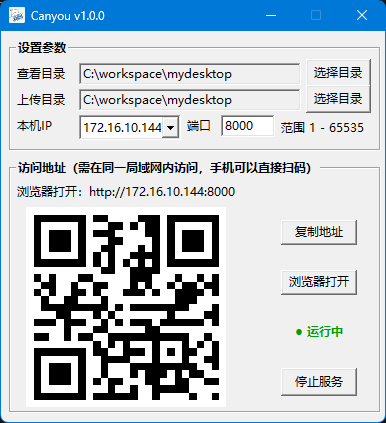
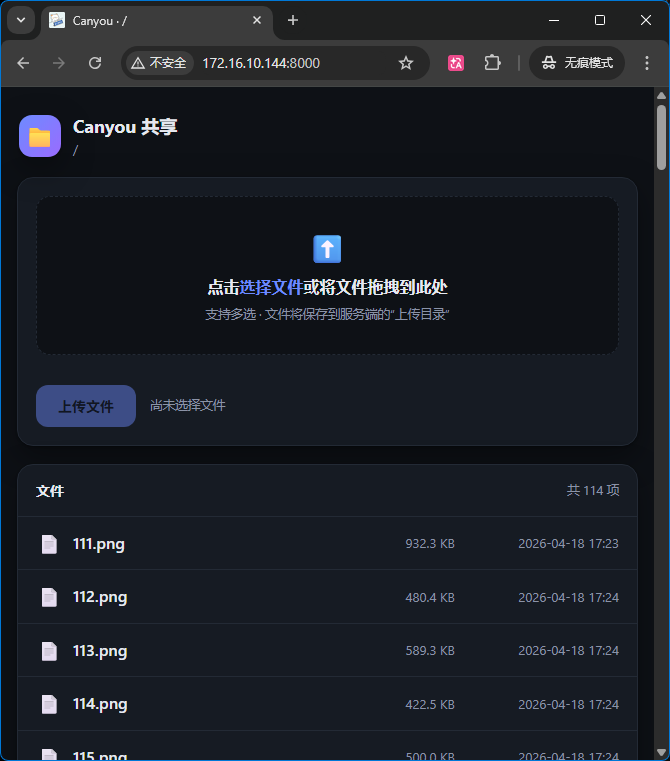

# Canyou

> 一个轻量的 Windows 桌面小工具：一键把本地文件夹共享到局域网，手机 / 同网段设备扫码即可浏览、下载、上传。

**简体中文** · [English](./README.en.md)

📦 仓库地址：**<https://github.com/IsErWa/canyou>**

---

## 📸 界面预览

**服务端（桌面工具）** — 设置目录、选择本机 IP 与端口，自动生成访问二维码：



**客户端（浏览器网页）** — 手机 / 同网段设备扫码后即可浏览、下载、上传：



## ✨ 功能特性

-  **双目录配置**：分别设置「查看目录」（供浏览 / 下载）与「上传目录」（接收网页上传）
- 🖼️ **二维码直达**：选择本机 IP 与端口后自动生成访问二维码，手机扫码即开
- 🌐 **现代响应式网页**：自动适配深色 / 浅色模式，支持拖拽多文件上传
- 🔗 **一键操作**：复制访问地址、用默认浏览器打开（仅在服务运行且地址有效时可用）
- ▶️ **启停可控**：单个按钮切换「启动 / 停止共享」，运行状态以灰 / 绿两色实时显示
- 💾 **配置持久化**：目录、端口、上次选中的 IP 自动保存到 `%AppData%/Canyou/config.json`
- 🛡️ **健壮的端口处理**：端口输入框仅允许数字并限制 1–65535；端口被占用 / 被系统保留时给出中文友好提示
- 🪟 **无控制台黑框**：以 GUI 子系统编译，启动即用，不闪命令行窗口

## 🖥️ 系统要求

- **操作系统**：仅支持 **Windows**（依赖 Win32 GUI）
- **网络**：访问方需与本机处于**同一局域网**
- 无需安装运行库（纯 Go 静态编译，禁用 CGO）

## 🚀 使用方法

1. 双击运行 `Canyou.exe`
2. 选择「查看目录」（可选「上传目录」）
3. 选择本机 IP、输入端口（默认 `8080`）
4. 点击「启动共享」
5. 用手机扫描界面中的二维码，或在同网段设备浏览器打开 `http://<IP>:<端口>`

> 运行中修改目录或端口会即时生效；若把端口清空 / 改成非法值，服务会自动停止。

## 🔨 从源码构建

获取源码：

```bash
git clone https://github.com/IsErWa/canyou.git
cd canyou
```

前置依赖：

- [Go](https://go.dev/dl/) 1.22 及以上
- `goversioninfo`（用于嵌入图标与版本信息），首次安装：

  ```bash
  go install github.com/josephspurrier/goversioninfo/cmd/goversioninfo@latest
  ```

构建（Windows）：

```bat
build.bat
```

脚本会依次生成 `resource.syso` 并编译出 `Canyou.exe`，关键参数：

```
go build -trimpath -ldflags "-s -w -H=windowsgui" -o Canyou.exe .
```

- `-s -w`：去除符号表与调试信息，减小体积
- `-H=windowsgui`：GUI 子系统，运行时不分配控制台窗口
- `CGO_ENABLED=0`：纯 Go 静态编译

## 🧱 技术栈

| 类别 | 选型 |
| --- | --- |
| 语言 | Go 1.22+ |
| 桌面 GUI | [tadvi/winc](https://github.com/tadvi/winc)（Win32 封装） |
| 二维码 | [skip2/go-qrcode](https://github.com/skip2/go-qrcode) |
| 文件服务 | 标准库 `net/http` |
| 版本信息 / 图标 | `goversioninfo` + `go:embed` |

## 📁 项目结构

```
.
├── main.go          # 界面搭建、交互逻辑、启停与配置
├── server.go        # 基于 net/http 的目录共享服务（启动 / 停止 / 端口错误处理）
├── upload.go        # 网页端目录浏览与文件上传处理
├── qrcode.go        # 访问地址生成二维码 PNG
├── netinfo.go       # 扫描本机局域网 IPv4 地址
├── config.go        # 配置持久化（%AppData%/Canyou/config.json）
├── icon.go          # 内嵌图标资源
├── statuslabel.go   # 自绘状态标签（灰 / 绿双色）
├── numericedit.go   # 仅数字输入的原生编辑框（端口）
├── build.bat        # 构建脚本
└── versioninfo.json # EXE 版本信息与图标
```

## ⚠️ 注意事项

- 本工具面向**局域网内**的文件共享，**不具备加密与访问控制**，请勿在不可信网络下共享敏感目录。
- 若某端口无法监听，可能是被其它程序占用，或落在 Windows / Hyper-V 的**系统保留端口区间**，换一个端口即可。
- 上传大小上限为单次请求 2 GB。

## 📄 许可

Copyright © 2026 ErWa. All rights reserved.
